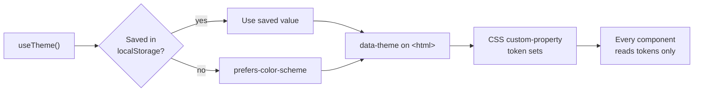
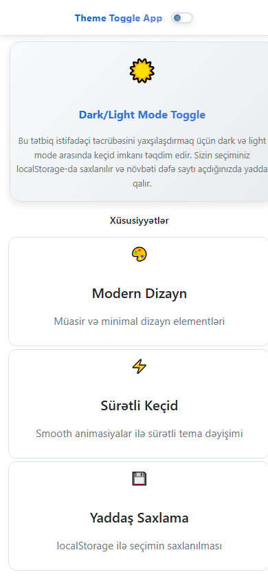

<h1 align="center">Theme Toggle</h1>

<p align="center"><b>A dark / light theme switcher with animated transitions, system-preference detection and a persisted choice.</b></p>

<p align="center">
<a href="https://dark-mode-togglee.netlify.app/"></a>


</p>

<p align="center"><a href="https://dark-mode-togglee.netlify.app/"><b>Live demo</b></a> &nbsp;·&nbsp; <a href="#quick-start">Quick start</a> &nbsp;·&nbsp; <a href="#features">Features</a> &nbsp;·&nbsp; <a href="#architecture">Architecture</a> &nbsp;·&nbsp; <a href="#faq">FAQ</a></p>

<p align="center">
  <a href="https://dark-mode-togglee.netlify.app/">
    
  </a>
</p>

<p align="center"><sub>Live capture of the real build — 801 KB, loops forever.</sub></p>

## Overview

A small app that does one thing properly: it swaps the whole interface between a dark and a light theme and remembers what you picked.

Theming is driven entirely by CSS custom properties — `themes.css` defines the token set for each theme and a single attribute on `<html>` switches between them, so no component needs to know which theme is active. The `useTheme` hook owns the logic: read the saved value, otherwise fall back to `prefers-color-scheme`, then keep `localStorage` and the DOM in sync.

The transition itself is animated with Framer Motion so the switch reads as a deliberate change rather than a flicker.

## At a glance

| Field | Detail |
| --- | --- |
| **Type** | Web application — Vite build |
| **Primary language** | CSS |
| **Live demo** | [dark-mode-togglee.netlify.app](https://dark-mode-togglee.netlify.app/) |
| **Repository** | [Mister2314/Dark-Mode-Toggle](https://github.com/Mister2314/Dark-Mode-Toggle) |

## Features

- Dark / light themes defined as CSS custom-property token sets
- `useTheme` hook — reads the stored theme, falls back to `prefers-color-scheme`
- Choice persisted to `localStorage` and restored on reload
- Animated card and feature-list entrance with Framer Motion spring transitions
- Reusable `Layout` component plus a dedicated `ThemeToggle` component
- Component-scoped styling with CSS Modules

## Tech Stack

| Layer | Technology |
| --- | --- |
| UI | React 19 |
| Animation | Framer Motion |
| Theming | CSS custom properties, `localStorage`, `prefers-color-scheme` |
| Styling | CSS Modules |
| Build | Vite, ESLint |

## Architecture



## Screenshots

| Desktop | Mobile |
| :---: | :---: |
|  |  |

## Quick Start

```bash
git clone https://github.com/Mister2314/Dark-Mode-Toggle.git
cd Dark-Mode-Toggle
npm install
npm run dev
```

## Project Structure

```
src/hooks/useTheme.js — theme state, persistence and system-preference detection
src/styles/themes.css — the token set for each theme
src/components/ThemeToggle/ — the switch itself
src/components/Layout/ — page shell that consumes the tokens
src/App.jsx — demo content showing the theme in use
```

## FAQ

<details>
<summary><b>How is the theme actually applied?</b></summary>

One attribute on `<html>`. `themes.css` defines a token set per theme, and every component styles itself from those tokens — so no component knows which theme is active.

</details>

<details>
<summary><b>What happens on the very first visit?</b></summary>

There is nothing in `localStorage`, so the hook falls back to the `prefers-color-scheme` media query and matches the operating system.

</details>

<details>
<summary><b>How would I add a third theme?</b></summary>

Write one more block of custom properties and add its name to the toggle. Nothing in the React tree changes.

</details>

## Roadmap

- [ ] Respect `prefers-reduced-motion` for the transition
- [ ] Add a system / light / dark tri-state option
- [ ] Cover the toggle with an accessibility test

## Notes

The point of this project was to learn that theming belongs in tokens, not in components. Once the palettes are custom properties, adding a third theme is a matter of writing one more block of CSS — nothing in the React tree changes.

## Author

**Xəyal Hüseynli** — Junior Front-End Developer

[Portfolio](https://hypnosdev.vercel.app) · [GitHub](https://github.com/Mister2314) · [LinkedIn](https://www.linkedin.com/in/x%C9%99yal-h%C3%BCseynli-3487b91ba/) · [xeyalhuseynli06@gmail.com](mailto:xeyalhuseynli06@gmail.com)
