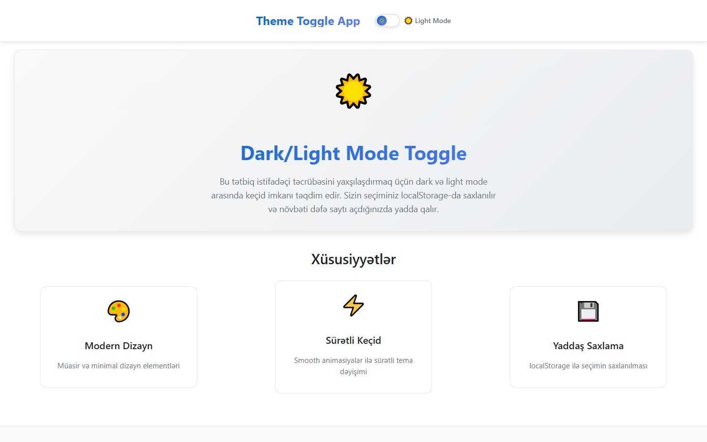
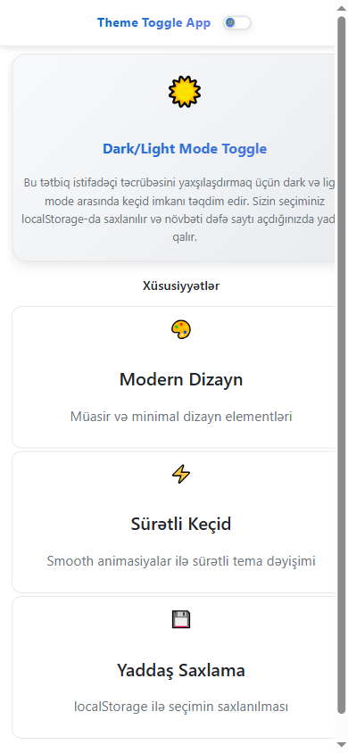

# Solstice — Dark Mode Toggle

A React day/night theme switch where the toggle is the hero: pressing it runs a radial
wipe and morphs a full sky scene — sun to moon, daylight to starfield — not just a class
swap.

**Live demo:** https://dark-mode-togglee.netlify.app/

<div align="center">


| Desktop | Mobile |
|---|---|
|  |  |

<details>
<summary>More screenshots</summary>

| Desktop | Mobile |
|---|---|
|  |  |

</details>

</div>

## What it does

A `useTheme` hook owns the whole flow. It stores your choice as `light`, `dark` or
`system`; while in `system` mode it follows `prefers-color-scheme` live through a
`matchMedia` listener. The choice is applied by an inline script in `index.html` before
React hydrates, so a reload never flashes the wrong theme.

The transition itself uses the View Transitions API where available: the button records
its position, `document.startViewTransition` captures the frame, and a clip-path circle
wipes the new theme outward from the knob. Browsers without View Transitions fall back
to the CSS token crossfade. Under `prefers-reduced-motion`, both paths collapse to an
instant swap.

## The scene

The hero is a CSS/SVG sky that answers the theme state: an orb springs from sun to moon,
42 stars fade in with staggered delays, two mountain ranges re-ink, and the sky gradient
crosses from daylight warm to night indigo. Each element opts in with a `data-anim`
attribute and a `--d` delay token, so the page settles in choreography instead of all at
once. No WebGL, no images — the whole scene is a few hundred bytes of markup.

## Features

- Scene-morph transition: radial wipe (View Transitions API) + spring sun/moon morph + star fade
- System-preference sync: follows OS changes live, with a "Follow system" chip to hand control back
- Persisted choice in `localStorage`, applied pre-hydration (no FOUC)
- Dual-mode preview cards and a verified contrast sheet in the page itself
- Keyboard accessible: native buttons, visible focus rings, `aria-pressed` state
- Reduced motion: instant swap, no wipe, no scene drift
- WCAG AA in both modes: body text 13.3:1 / 15.6:1, secondary 6.0:1 / 8.7:1, accents 6.3:1 / 9.7:1

## Tech stack

React 19 · Framer Motion · View Transitions API · CSS Modules · Vite

## Run locally

```bash
git clone https://github.com/Mister2314/Dark-Mode-Toggle.git
cd Dark-Mode-Toggle
npm install
npm run dev
```

Also available: `npm run build`, `npm run preview`, `npm run lint`.

## What I learned

Two kinds of theme transition exist: swapping tokens (fast, boring) and swapping *time of
day* (one orchestrated moment). The trick that made the second affordable was keeping
every animated property owned by exactly one layer — CSS variables drive the colors,
Motion drives the springs, and the View Transition drives the frame — so nothing fights
over the same pixels. Adding a third theme would still be one more token block.

Mirrored deploy: [Vercel](https://dark-mode-toggle-mister2314.vercel.app/)
