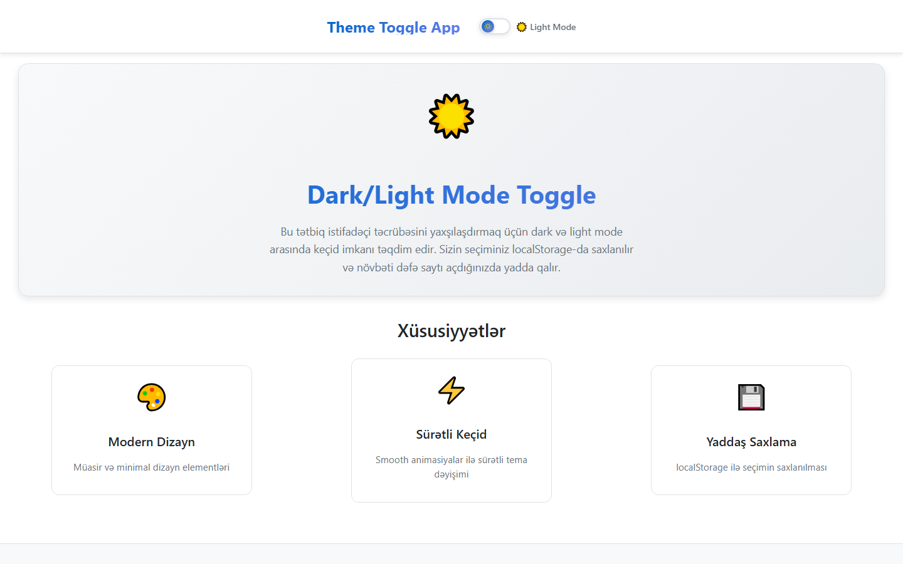

# Dark Mode Toggle

A React dark / light theme switcher that detects the system preference, animates the transition and persists the choice.

**Live demo:** https://dark-mode-togglee.netlify.app/



## What it does

A `useTheme` hook owns the whole flow: it reads `localStorage`, falls back to `prefers-color-scheme` on first visit, and keeps both the stored value and the `data-theme` attribute on `<html>` in sync. Every component styles itself from CSS custom-property token sets, so no component needs to know which theme is active. Entrance animations are spring transitions via Framer Motion.

## Tech stack

React 19 · Framer Motion · CSS Modules · Vite

## Features

- `useTheme` hook — persistence, `prefers-color-scheme` fallback, DOM sync in one place
- Themes defined as CSS custom-property token sets, switched by one attribute on `<html>`
- Choice restored from `localStorage` on reload
- Animated card and feature-list entrance with Framer Motion springs
- Reusable `Layout` and `ThemeToggle` components, scoped styles with CSS Modules

## Run locally

```bash
git clone https://github.com/Mister2314/Dark-Mode-Toggle.git
cd Dark-Mode-Toggle
npm install
npm run dev
```

Also available: `npm run build`, `npm run preview`, `npm run lint`.

## What I learned

Moving theming into tokens instead of components meant adding a third theme is one more block of CSS — nothing in the React tree changes.
